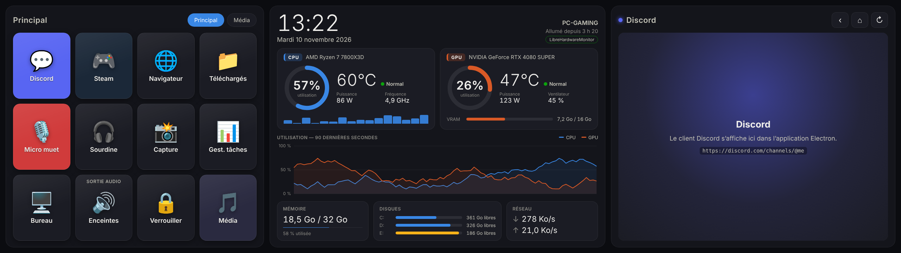

# Xeneon Edge Widget

Tableau de bord tactile plein écran pour l'écran **Corsair Xeneon Edge** (2560×720) :

| Stream Deck | Système | Discord |
|---|---|---|
| Grille de boutons tactiles configurables (lancer une appli, ouvrir une URL, raccourcis clavier, touches multimédia, macros…) avec plusieurs pages | Horloge, CPU & GPU (utilisation, température, puissance, fréquence, ventilateur, VRAM), charge par cœur, historique 90 s, mémoire, disques, réseau | Le client web Discord intégré (connexion mémorisée), avec boutons retour / accueil / recharger |



C'est une application [Electron](https://www.electronjs.org/) qui s'ouvre en plein écran sur le Xeneon Edge (détecté automatiquement) ; Windows voit l'Edge comme un écran secondaire.

## Installation

Prérequis : Windows 10/11 et [Node.js](https://nodejs.org/) 20 ou plus récent.

```bash
git clone https://github.com/ttiennot/XeneonEdgeWidget.git
```

```bash
cd XeneonEdgeWidget
```

```bash
npm install
```

```bash
npm start
```

Au premier lancement, `config.json` est créé à partir de `config.example.json`. Toute modification de ce fichier est appliquée **à chaud** (pas besoin de redémarrer).

Une icône dans la zone de notification permet de recharger, d'ouvrir la configuration, d'activer le lancement au démarrage de Windows et de quitter.

Pour générer un `.exe` portable (dans `dist/`) :

```bash
npm run dist
```

> Avec l'exécutable, la configuration se trouve dans `%APPDATA%\Xeneon Edge Widget\config.json` (menu de l'icône > *Modifier la configuration…*).

## Températures : LibreHardwareMonitor (recommandé)

Windows ne fournit pas les températures CPU de façon fiable. Pour des valeurs précises (CPU, GPU NVIDIA/AMD/Intel, puissances, VRAM) :

1. Installez [LibreHardwareMonitor](https://github.com/LibreHardwareMonitor/LibreHardwareMonitor/releases) et lancez-le **en administrateur**.
2. Menu *Options* > *Remote Web Server* > *Run* (port 8085 par défaut).
3. Optionnel : *Options* > *Start Minimized*, *Minimize To Tray* et *Run On Windows Startup*.

Le badge **LibreHardwareMonitor** apparaît en haut à droite du panneau Système quand la connexion fonctionne.

Sans LibreHardwareMonitor, le widget utilise `nvidia-smi` (installé avec les pilotes NVIDIA) pour le GPU, et `systeminformation` pour le reste ; la température CPU peut alors rester sur « N/D ».

## Discord

Le panneau affiche le client web officiel (`https://discord.com/channels/@me`). Connectez-vous une fois (identifiants ou QR code avec l'appli mobile) : la session est conservée.

- `discord.zoom` (0,5 à 1) règle la taille du texte pour faire tenir plus de contenu.
- Un bouton peut ouvrir directement un salon : `{ "type": "discord", "url": "https://discord.com/channels/<serveur>/<salon>" }`.
- Autres contenus possibles dans `discord.url` :
  - widget d'un serveur (membres en ligne, salons vocaux) : `https://discord.com/widget?id=<ID_SERVEUR>&theme=dark` (à activer dans *Paramètres du serveur > Widget*) ;
  - n'importe quelle page `https://`.

**Boutons micro / casque** : les raccourcis `Ctrl+Maj+M` / `Ctrl+Maj+D` de Discord ne fonctionnent que quand l'appli Discord a le focus. Pour qu'ils marchent partout, définissez des raccourcis globaux dans Discord (*Paramètres > Raccourcis clavier*), par exemple `Ctrl+Maj+F13`, puis utilisez la même combinaison dans le bouton : `"keys": "ctrl+shift+f13"`.

## Configuration

Extrait commenté de `config.json` :

```jsonc
{
  "display": {
    "target": "auto",       // "auto" = détecte l'écran 2560x720 ; sinon index de l'écran (0, 1, 2…)
    "alwaysOnTop": false,
    "zoom": 1               // agrandit / réduit toute l'interface
  },
  "autostart": false,       // lancer au démarrage de Windows (version .exe)
  "layout": {
    "panels": ["deck", "stats", "discord"],  // ordre ; retirez un panneau pour le masquer
    "widths": [1, 1.3, 1.1]                  // largeurs relatives
  },
  "theme": { "accent": "#3987e5" },
  "stats": {
    "intervalMs": 1000,
    "librehardwaremonitor": { "enabled": true, "url": "http://localhost:8085/data.json" },
    "nvidiaSmi": true,
    "disks": [],            // ex. ["C:", "D:"] ; vide = tous
    "tempWarning": 70,      // °C -> état « Chaud »
    "tempCritical": 85      // °C -> état « Critique »
  },
  "deck": {
    "columns": 4,
    "rows": 3,
    "pages": [ { "name": "Principal", "buttons": [ /* … */ ] } ]
  },
  "discord": { "url": "https://discord.com/channels/@me", "zoom": 0.8 }
}
```

L'écran Edge peut aussi être monté en **portrait** (720×2560) : les panneaux s'empilent alors verticalement.

### Boutons

```jsonc
{ "label": "Steam", "icon": "🎮", "color": "#1b2838", "action": { "type": "url", "url": "steam://open/games" } }
```

- `icon` : un emoji, ou le chemin d'une image (`C:\\Icones\\obs.png`, `https://…`). Sans icône, l'icône du programme est utilisée pour les actions `app`.
- `color` : couleur de fond du bouton (facultatif).
- Un objet vide `{}` laisse une case vide.

| Type | Paramètres | Exemple |
|---|---|---|
| `app` | `path`, `args`, `cwd` | `{ "type": "app", "path": "C:\\Program Files\\OBS Studio\\bin\\64bit\\obs64.exe" }` |
| `url` | `url` | `{ "type": "url", "url": "https://twitch.tv" }` |
| `folder` / `file` | `path` | `{ "type": "folder", "path": "%USERPROFILE%\\Documents" }` |
| `command` | `command` | `{ "type": "command", "command": "shutdown /s /t 60" }` |
| `hotkey` | `keys` | `{ "type": "hotkey", "keys": "ctrl+alt+f9" }` |
| `media` | `key` : `playpause`, `next`, `prev`, `stop`, `volumeup`, `volumedown`, `mute` | `{ "type": "media", "key": "next" }` |
| `text` | `text` | `{ "type": "text", "text": "GG WP !" }` |
| `page` | `page` (index ou nom) | `{ "type": "page", "page": "Média" }` |
| `discord` | `url` | `{ "type": "discord", "url": "https://discord.com/channels/123/456" }` |
| `multi` | `actions`, `delayMs` | `{ "type": "multi", "actions": [ … ], "delayMs": 300 }` |
| `browser` | `browser`, `profile`, `urls`, `userDataDir`, `newWindow` | voir [Navigateur avec un profil](#navigateur-avec-un-profil-et-des-onglets) |
| `sonar` | `toggle` ou `device`, `channels` | voir [SteelSeries Sonar](#steelseries-sonar--basculer-enceintes--casque) |

Les chemins acceptent les variables d'environnement (`%LOCALAPPDATA%`, `%USERPROFILE%`…).

Touches reconnues pour `hotkey` : `ctrl`, `shift`, `alt`, `win`, `a`–`z`, `0`–`9`, `f1`–`f24`, `enter`, `esc`, `tab`, `space`, `backspace`, `delete`, `insert`, `home`, `end`, `pageup`, `pagedown`, `up`, `down`, `left`, `right`, `printscreen`, `num0`–`num9`, touches multimédia, ponctuation.

> Quand vous touchez l'écran Edge, le widget prend le focus. Avant d'envoyer un raccourci ou du texte, il rend automatiquement le focus à la fenêtre précédente (jeu, navigateur…), comme un vrai Stream Deck.

## Navigateur avec un profil et des onglets

Un bouton peut ouvrir votre navigateur sur un profil précis (par exemple « Travail »), dans une nouvelle fenêtre, avec vos onglets de travail :

```json
{
  "label": "Travail",
  "icon": "💼",
  "action": {
    "type": "browser",
    "browser": "chrome",
    "profile": "Travail",
    "urls": [
      "https://mail.google.com",
      "https://calendar.google.com",
      "https://app.slack.com",
      "https://github.com"
    ]
  }
}
```

- `browser` : `chrome`, `edge`, `brave`, `vivaldi`, `firefox`, ou le chemin complet de l'exécutable.
- `profile` : le nom du profil tel qu'il apparaît dans le navigateur (« Travail ») ou son nom de dossier (« Profile 2 »). Pour voir les profils existants : menu de l'icône de notification > *Profils des navigateurs…*, ou `npm run browser-profiles`. Le profil doit déjà exister : créez-le d'abord dans le navigateur (Chrome : icône de profil > *Ajouter*).
- `urls` : les onglets à ouvrir. Sans `urls`, la fenêtre s'ouvre sur la page d'accueil du profil.
- `newWindow: false` : ajoute les onglets à une fenêtre existante du profil au lieu d'en ouvrir une nouvelle.
- `userDataDir` (Chrome, Edge, Brave, Vivaldi) : à la place de `profile`, un dossier de profil complètement séparé, créé automatiquement au premier lancement (ex. `"%LOCALAPPDATA%\\ProfilTravail"`).

Si le profil indiqué n'existe pas, un message liste les profils disponibles.

## SteelSeries Sonar : basculer enceintes / casque

Si vos sorties audio passent par **SteelSeries Sonar** (SteelSeries GG), un bouton peut changer le périphérique de sortie de Sonar. Chaque appui passe à la sortie suivante de la liste, et le bouton affiche la sortie active (il se resynchronise toutes les 10 s si vous la changez depuis GG).

```json
{
  "label": "Sortie audio",
  "action": {
    "type": "sonar",
    "toggle": [
      { "match": "Haut-parleurs", "label": "Enceintes", "icon": "🔊" },
      { "match": "Arctis", "label": "Casque", "icon": "🎧" }
    ]
  }
}
```

- `match` : une partie du nom Windows du périphérique (casse et accents ignorés). Pour voir les noms exacts : menu de l'icône de notification > *Périphériques audio SteelSeries Sonar…*, ou `npm run sonar-devices`.
- `label` / `icon` : ce qu'affiche le bouton quand cette sortie est active.
- `device` à la place de `toggle` : sélectionne toujours la même sortie (`{ "type": "sonar", "device": "Arctis" }`).
- `channels` (facultatif) : canaux Sonar à rediriger. Par défaut les 4 canaux de sortie `game`, `chat`, `media`, `aux` en mode classique ; en mode streamer, le mix personnel `monitoring` (ce que vous entendez). Le micro n'est jamais modifié.

SteelSeries GG doit être lancé avec Sonar activé. Le widget utilise l'API locale de Sonar, qui n'est pas documentée officiellement par SteelSeries : une mise à jour de GG pourrait la modifier.

## Développement

```bash
npm run dev       # fenêtre redimensionnable, même sans Xeneon Edge
```

```bash
npm run preview   # interface seule dans un navigateur, avec données simulées : http://localhost:5173/
```

```bash
npm test          # tests unitaires (LibreHardwareMonitor / nvidia-smi, raccourcis, configuration, Sonar, navigateurs)
```

Structure :

```
src/main.js          fenêtre plein écran, détection de l'écran, icône de notification, IPC
src/stats.js         collecte des statistiques (LibreHardwareMonitor, nvidia-smi, systeminformation)
src/actions.js       actions du Stream Deck (assistant PowerShell persistant pour le clavier)
src/sonar.js         pilotage de SteelSeries Sonar (changement de sortie audio)
src/browser.js       ouverture d'un navigateur sur un profil avec des onglets
src/config.js        chargement / validation / rechargement à chaud de config.json
src/preload.js       pont sécurisé entre l'interface et le processus principal
src/renderer/        interface (HTML / CSS / JS sans framework)
```
